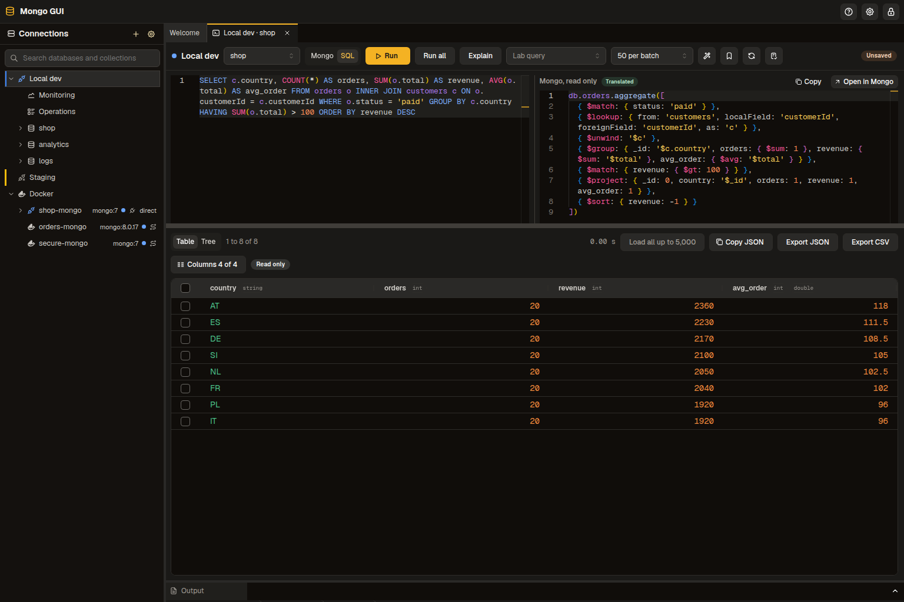

# Mongo GUI

Mongo GUI is a desktop client for MongoDB. It installs as a normal app on Linux, Windows and
macOS, with no server, no container and no browser tab to set up first.

You run mongosh statements in an editor and read the results as a grid, a tree or JSON. The same
window shows indexes, explain plans, the profiler, live server metrics and backups. The app is free
to use, modify and share. You may not sell it. The license is Apache 2.0 with the Commons Clause.

## Why Mongo GUI

| Tool            | Licence                        | Price                                                                                                           |
| --------------- | ------------------------------ | --------------------------------------------------------------------------------------------------------------- |
| Mongo GUI       | Apache 2.0 with Commons Clause | Free                                                                                                            |
| MongoDB Compass | SSPL                           | Free                                                                                                            |
| Studio 3T       | Commercial                     | Community Edition is free for non-commercial use and connects to up to three clusters. Paid editions cost more. |
| NoSQLBooster    | Commercial                     | Paid licence                                                                                                    |
| Robo 3T         | GPL v3                         | Free                                                                                                            |

- NoSQLBooster and Studio 3T are commercial desktop clients. Their full editions need a paid licence.
- MongoDB Compass is the official client. It is free, but the SSPL is source-available, not open source as the OSI defines it.
- Robo 3T is free. Its last stable release, 1.4, embeds the MongoDB 4.2 shell, not mongosh.
- Browser tools such as Mongo Express usually run in Docker. You start a container and open a browser tab before you see any data.

Mongo GUI keeps your connections in an encrypted store behind a master password, and it locks that
store when you step away. The next section covers how.

## The encrypted store and the store lock

Saved connections, with their credentials, plus query history, favourites and settings live in one
encrypted store. A master password you type at launch unlocks it.

- The app encrypts each record with AES-256-GCM. A key derived from the master password with scrypt unwraps the random data key.
- The app never saves the master password and cannot recover it. If you lose it, the stored data is gone. "Reset store" on the unlock screen deletes everything in the store.
- The app locks after 30 minutes without activity by default. Change the period under "Idle lock (minutes)" in Settings.
- To lock at once, press Ctrl+L (Cmd+L on macOS), click "Lock" in the toolbar, or click "Lock now" in Settings.
- Locking closes every open connection and clears the data key from memory.

The lock does not stop code that runs as your user while the app is unlocked. Lock the app when you
step away from the machine. See [docs/security.md](docs/security.md) for the threat model and the key
hierarchy.

## Features

**Connect**

- Connect by URI or by a form. Saved connections go into the encrypted store.
- Docker discovery finds MongoDB containers on the local machine and connects to them.
- Replica sets show their members, lag and elections, and reconfigure after a dry run.
- Sharded clusters show shards, sharded collections, chunks and the balancer.

**Query**

- The editor runs mongosh statements with completion for collections, fields and operators. It runs multi-statement scripts and prints their output.
- SQL mode runs a T-SQL subset against collections. The tab shows the translated mongosh beside the editor, read only.
- Results open as a grid, an expandable tree with inline edits, or read-only JSON.
- Explain shows the plan of find, aggregate, count, distinct, update and delete as a graph of stage cards, with warnings.
- Generate data inserts made-up documents with unique fields, a preview and cancel.

**Manage**

- Databases, collections, indexes, JSON schema validators and documents.
- Users and roles, with their privileges.
- GridFS buckets and files, with upload, download and metadata edits.
- Change streams on a collection, a database or a deployment, with resume tokens.
- Schema analysis reports the types, presence and examples of fields in sampled documents.
- Import JSON or CSV through a field mapping wizard. Export JSON, NDJSON or CSV.
- Backup and restore run the bundled MongoDB Database Tools. Each backup writes a JSON description file, and a restore warns about tools versions that could corrupt data.

**Monitor**

- A monitoring dashboard charts server metrics in panels you choose from a catalogue of 30. The layout is saved for each connection.
- The running operations list shows what the server is doing now.
- The profiler lists slow operations, the top query shapes and the profiling level of each database.
- Diagnostics show the server log, parameters, serverStatus, host information and sessions.

## Screenshots


Results of a find open as a grid. The tree and JSON views show the same result.

A SQL tab shows the mongosh it runs, beside the editor.



The monitoring dashboard charts server metrics as they arrive.


Explain shows the plan of an aggregate as a graph of stage cards, with the measured `$lookup` pipeline beside the outer plan.


The profiler lists slow operations and the top query shapes of a database.


Diagnostics show the server log with filters for level, component and text.


## Development

See [CONTRIBUTING.md](CONTRIBUTING.md) for the prerequisites, the scripts, the gates and the coding
standards. `pnpm dev` starts the app with hot reload. `pnpm dev:ui` serves the UI in a browser
against an in-memory mock backend.

## Packaging and releases

`pnpm dist` builds the app and writes installers for the current platform to
`packages/app/release/`. It publishes nothing. Before it packages the app, `pnpm dist` fetches
the MongoDB Database Tools pinned in `packages/app/mongo-tools.json` and bundles them on Linux
x64 and Windows x64. Other platforms bundle no tools. The fetch script caches the archive in
`packages/app/.cache/` and checks it against the pinned sha256. Linux builds an AppImage and a `.deb`,
Windows builds an NSIS installer, and macOS builds a DMG and a ZIP for both x64 and arm64.

Releases come from CI. To release a version:

1. Bump `version` in `packages/app/package.json`, commit, and push.
2. Tag the commit and push the tag:

   ```sh
   git tag v0.1.0
   git push origin v0.1.0
   ```

The tag must match the version in `packages/app/package.json`. The `prepare` job stops the
release before any build starts if they differ.

The `prepare` job creates a draft GitHub Release for the tag. The builds on Ubuntu,
Windows and macOS then run in parallel and upload their installers to that draft. When all
three builds succeed, a final job marks the release public. If one build fails, the
release stays a draft, so users never see a partial set of files. Fix the failure and
re-run the failed job from the Actions page. The re-run adds its files to the same draft.

A manual run of the workflow from a branch builds the installers and keeps them as
workflow artifacts for seven days. A manual run from a tag ref behaves like a tag push: it
validates the version, publishes to the draft release, and marks it public.

The builds are unsigned for now. On Windows, SmartScreen shows "Windows protected your PC"
on the first run. Choose "More info", then "Run anyway". On macOS, the builds use ad-hoc
signing, which needs no certificate. Gatekeeper still refuses the first launch with a
"cannot verify the developer" dialog. Open System Settings, go to Privacy and Security,
and choose "Open Anyway". On Linux, no signature check applies. Run `chmod +x` on the
AppImage, or install the `.deb` with `apt install ./<file>.deb`.

Downloads appear on the [Releases page](https://github.com/eriksimonic/mongodb-gui/releases).
The changes in each version are listed in [CHANGELOG.md](CHANGELOG.md).

### Updates

The app checks GitHub for a new release about ten seconds after you unlock it, and then every
six hours. The check runs in the background and never delays startup. The setting lives in the
encrypted store, so the first check waits for the master password. A check that fails, for
example while the machine is offline, stays out of sight, and the app tries again on the next
schedule. An available update shows a notice in the toolbar with its version.

On the AppImage and the Windows installer, the app downloads the update when you choose
Download. When the download finishes, choose Restart to update. Choose Later to keep working,
and the update installs the next time you quit. On the `.deb` package and on macOS, the app
cannot replace itself. It shows the version and a Download from GitHub link, and you install
the new version by hand.

Turn off "Check for updates" in Settings to stop all checks. The app then makes no requests to
GitHub until you turn the setting back on.

## Third-party software

Linux and Windows builds include unmodified MongoDB Database Tools (mongodump, mongorestore)
under the Apache License 2.0. MongoDB is a trademark of MongoDB, Inc.; this project is not
affiliated with or endorsed by MongoDB.

The tools' licence and third-party notices ship next to the binaries in every install folder,
both for the bundled tools and for downloaded versions.

## Documentation

- [User guide](docs/user-guide.md): every screen and workflow of the app.
- [SQL translation](docs/sql.md): the T-SQL subset that SQL mode runs, its functions and the constructs it refuses.
- [Security](docs/security.md): the threat model, key hierarchy and where data is stored.
- [Troubleshooting](docs/troubleshooting.md): connection errors, Docker, updates, logs and bug reports.
- [Keyboard shortcuts](docs/shortcuts.md): every shortcut the app registers.
- [Architecture](docs/architecture.md): processes, packages, the RPC contract and the test layers.
- [Contributing](CONTRIBUTING.md): setup, scripts, gates and coding standards.

## License

Apache License 2.0 with the Commons Clause. You may use, modify and share the app, and build on
it in your own products. You may not sell it, which includes charging for hosting it or for
support and consulting where the value comes substantially from the app. The source is available,
but this is not an open source license. See [LICENSE](LICENSE). Versions up to 0.2.0 stay under
the MIT license.
