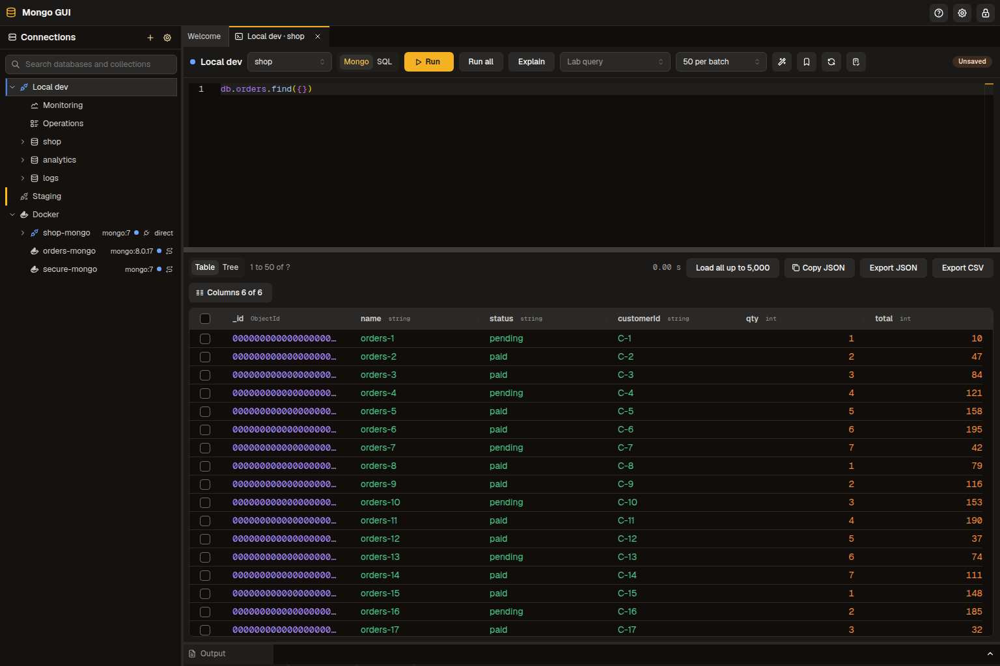
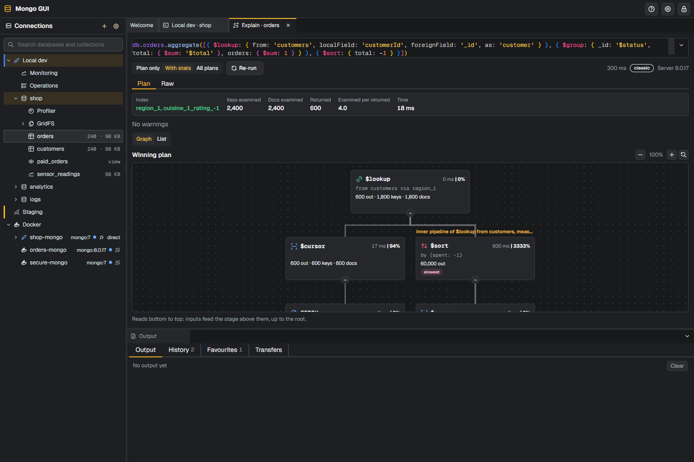
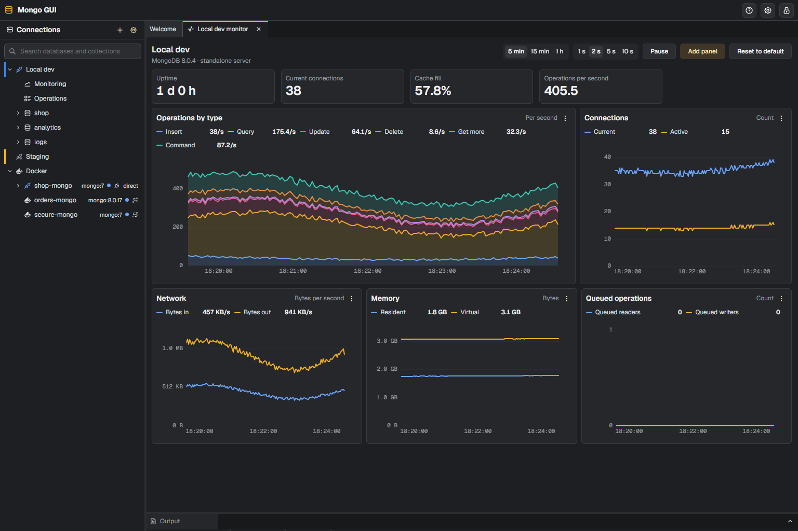
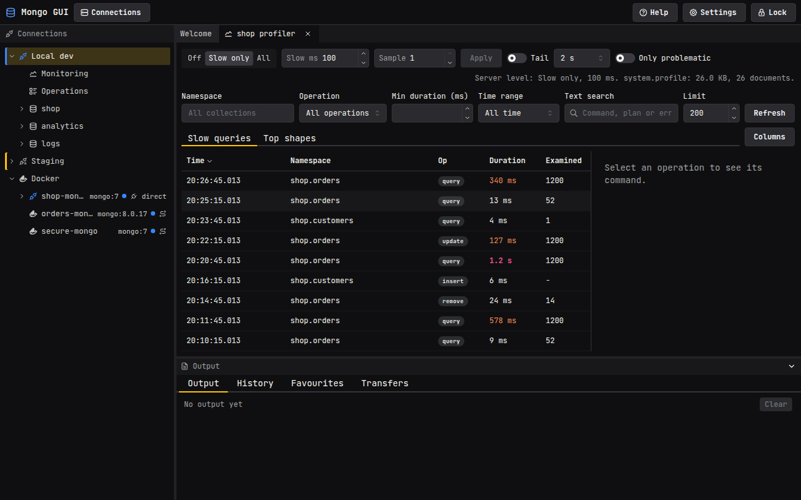
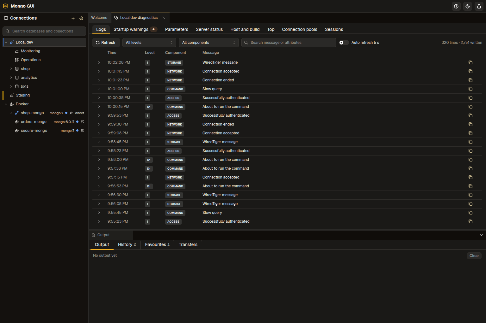

# User guide

This guide describes the Mongo GUI desktop app as shipped in version 0.4.0. Labels in
quotes are the text on the buttons, menus and fields.

## Contents

- [First launch and the master password](#first-launch-and-the-master-password)
- [Connections](#connections)
- [Docker discovery](#docker-discovery)
- [The connection tree](#the-connection-tree)
- [The editor](#the-editor)
- [Results](#results)
- [Explain](#explain)
- [SQL mode](#sql-mode)
- [Collection management](#collection-management)
- [Monitoring](#monitoring)
- [Profiler](#profiler)
- [Import and export](#import-and-export)
- [Schema analysis](#schema-analysis)
- [Users and roles](#users-and-roles)
- [Replica set](#replica-set)
- [Sharding](#sharding)
- [Diagnostics](#diagnostics)
- [Storage usage](#storage-usage)
- [GridFS](#gridfs)
- [Change streams](#change-streams)
- [Backup and restore](#backup-and-restore)
- [Settings and appearance](#settings-and-appearance)
- [Updates](#updates)

## First launch and the master password

The app stores saved connections, query history, favourites and settings on disk. A master
password encrypts all of them. The password never leaves your machine, and the app keeps no
copy of it. See [security.md](security.md) for the details.

On the first launch, the app shows the first-run screen.

1. Type a master password in "Master password". The password must have at least 4 characters. The strength meter still rates anything under 10 as weak.
2. Type the same password in "Confirm master password". The strength meter shows how strong the
   password is.
3. Click "Create vault".

Every later launch shows the unlock screen before any other content.

1. Type the master password in "Master password".
2. Click "Unlock". A wrong password shows "The master password is incorrect." Each failed
   attempt waits half a second before the app checks again.

Keep the master password safe. The app cannot recover it. A forgotten password means the
stored data cannot be read again. To start over, use "Reset store" on the unlock screen. Type
`DELETE` in the confirmation field and click "Delete store". The reset deletes every saved
connection, history entry, favourite and setting.

The app locks itself after a period without activity. The default is 30 minutes. Change it
under "Idle lock (minutes)" in Settings, in the Security section. To lock the app at once,
use one of these:

- Click "Lock" in the toolbar.
- Press Ctrl+L, or Cmd+L on macOS.
- Open Settings and click "Lock now".

Locking closes every open connection and clears the key from memory.

To change the master password, open Settings, go to Security, and click "Change master
password". Type the current password, then the new password twice. The app re-wraps its key
under the new password. It does not rewrite your data.

## Connections

### Create a connection

1. Click "New connection" in the toolbar. The dialog opens in form mode.
2. Type a name in "Name". Pick a colour in "Colour" to tell connections apart in the tree.
3. Fill in the fields described below, or switch the "Connection string mode" control to
   "URI" and paste a connection string.
4. Click "Test connection". The result line reports the server version and the topology, or
   the error from the server.
5. Click "Save".

The form mode has these fields:

- "Scheme" chooses `mongodb` or `mongodb+srv`.
- "Hosts" lists one or more hosts. Click "Add host" to add a row. Each row has a host name and
  port. Use `localhost:27017` for a local server.
- "Default database" and "Auth database".
- "User name" and "Password".
- "Replica set name" for a replica set.
- "Read preference" with a list of the standard read preferences.
- "Connect timeout (ms)" for how long the app waits before it gives up.
- "Use TLS" turns TLS on. When it is on, "Allow invalid certificates" skips certificate
  checks, and "CA file path" and "Client certificate file path" name the files to use.

The URI mode accepts a `mongodb://` or `mongodb+srv://` string. The app splits the string into
the form fields when you switch back to form mode. A malformed string shows a message instead.

Connection strings with a password are stored encrypted. The app never shows a stored password
in logs or in the tree. Context menus copy the URI with the password masked.

### Connect

1. Find the connection in the tree, or open the "Connections" panel from the toolbar.
2. Right-click the connection and choose "Connect". You can also select the row and press
   Enter.

The tree shows the server's databases once the connection opens. Choose "Disconnect" from the
same menu to close it. Hover the status icon to see the server topology. A replica set shows its
set name to the right of the connection name. When the URI has `directConnection=true`, the row
also says "direct": the app talks to that one member only, and a write to a secondary fails.
Double-clicking a collection opens its documents in a query tab, or brings that tab to the front
when it is already open.

### Connection manager

The "Connections" button in the toolbar opens the connection manager. It lists every saved
connection as a table row with the columns "Name", "Server", "Security", "Color" and "Last
accessed". Click a column heading to sort by it, and click it again to reverse the order. Type in
the field under a heading to filter the rows by that column. Each row has two icon buttons. The
"Edit" button opens the connection dialog. The "Delete" button opens a "Remove connection"
confirmation. Removing a connection also deletes its saved query history.

## Docker discovery

The app can find MongoDB containers on the local machine. The Docker node appears in the
connection tree. When the app cannot reach the Docker Engine, the node shows the reason.

The app lists a container in two cases. The container uses one of these images: `mongo`,
`mongodb/*`, `bitnami/mongodb` or `percona/percona-server-mongodb`. Or the container exposes
port 27017. The list includes stopped containers. Each container row shows its name, image tag and
state. The list refreshes every 10 seconds. A stopped container does not accept a connection, so
start it first.

To connect to a container, select its row and press Enter, or choose "Connect" from its menu.
The app uses these routes:

- A container that publishes port 27017 connects through the host port.
- A container that does not publish port 27017 connects through a forwarder. The app starts
  a small `alpine/socat` container on the same Docker network. The forwarder publishes a free
  loopback port and relays traffic to the MongoDB container. The app labels the forwarder
  `mongo-gui.forwarder`. It removes the forwarder when you disconnect, when you quit the app,
  and when it starts. The app pulls the forwarder image when the machine does not have it.
  The forwarder requires a client certificate (mutual TLS). The app makes a new certificate pair
  for each forwarder, valid for 7 days, and connects with it. The certificate files sit in a
  private temporary directory that the app deletes with the forwarder. Other tools on the
  machine cannot use the forwarder port without them.

If the container sets `MONGO_INITDB_ROOT_USERNAME` and `MONGO_INITDB_ROOT_PASSWORD`, the app
fills in the user name and password for you.

If the server needs a user name and password that the container does not set, or the container's
own credentials are rejected, the app opens a dialog. Type a user name and password, and check
the authentication database. It is usually `admin`, the database that holds the user. The app
tests the credentials first. If the test fails, the dialog shows the error and stays open. On
success, the app saves the credentials in the encrypted vault on the container's connection, so
the next connect does not ask again.

The right-click menu on a container offers "Open container details" and "Copy URI (redacted)".
The details panel lists the container id, image, networks and environment variable names. It
does not show their values.

Requirements:

- Docker Engine running on the machine. On Linux and macOS, the app uses `/var/run/docker.sock`.
  On Windows, it uses the `docker_engine` named pipe. A `DOCKER_HOST` value that starts with
  `unix://` takes precedence on Linux and macOS.
- Read access to the socket. On Linux, add your user to the `docker` group and sign in again.
- A way to pull the `alpine/socat` image when a container needs a forwarder.

Turn on "Connect Docker instances automatically" in Settings to connect to every discovered
container when the app starts. The setting is off by default.

## The connection tree

The left panel shows the connections. Each connected server has these nodes:

- Replica set. Shown when the server is a replica set member. It lists every member with its
  state, PRIMARY, SECONDARY or ARBITER, and marks the member this connection talks to. Right-click
  a member for "Connect directly", which saves a connection to that one host with the same
  credentials and opens it, or "Copy host". Double-click a member to connect directly too.

- Databases. Expand a database to see its collections, views and time series collections.
- Profiler. Opens the profiler.
- GridFS. Lists the buckets of a database.
- Monitoring. Holds two rows. "Monitoring" opens the monitor dashboard, and "Operations" opens
  the list of running operations.

Keyboard use in the tree:

1. Press Up and Down to move between rows.
2. Press Right to expand a node, and Left to collapse it.
3. Press Home and End to jump to the first or last row.
4. Press Enter to connect or open the selected row. On a database or collection it does what a
   double-click does, and the editor tab it opens has the cursor in it.
5. Press Shift+F10, or the context menu key, to open the menu for the row.
6. Type letters to filter the siblings of the focused row. Backspace shortens the filter, and
   Escape clears it.

Right-click a database or collection to see its menu. Related items sit in submenus, which open
when the pointer is over them or with Right. The collection menu offers these items:

- "Open in editor" opens an editor tab with `db.<collection>.find({})` and runs it.
- "Query" runs a SQL statement in a SQL tab, whatever the default editor language:
  "Select top 1000 rows" (`SELECT TOP 1000 * FROM <collection>;`), "Select first row"
  (`SELECT TOP 1 * …`) and "Count rows" (`SELECT COUNT(*) …`).
- "Collection" holds "Indexes", "Validation", "Analyse schema", "Collection stats", "Watch changes" and "Shard collection". The last one works on a sharded cluster only.
- "Import and export" holds "Import data", "Export data", "Generate data" and "Back up
  collection…".
- "Rename", "Clear" and "Drop" change the collection. Each one asks for confirmation.
- "Refresh" reloads the node.

Double-click a collection to open the same query tab as "Open in editor". A collection name that
is not a plain identifier, such as `daily-totals`, runs as `db.getCollection("daily-totals").find({})`.
So does a name that starts with `_`, contains `$` or matches a `db` method, such as `stats`.
If the active tab on the same connection is empty, the query replaces its text. Otherwise the query
opens a new tab.

The database menu offers "Open editor", "New collection", "New GridFS bucket", "Users and roles",
"Refresh" and "Drop database", and these submenus:

- "Monitoring": "Database stats", "Open profiler" and "Watch changes".
- "Import and backup": "Import data into new collection", "Back up database…" and "Restore into
  database…".

The connection menu offers "Connect", "Disconnect", "Open editor", "New database", "Edit",
"Refresh" and "Remove", and these submenus:

- "Monitoring": "Monitor", "Diagnostics" and "Watch changes".
- "Administration": "Users and roles", "Replica set" and "Sharding".
- "Backup": "Back up…" and "Restore…".

## Tabs

The centre area holds dock tabs for the editors, documents, indexes and other panels. Right-click
a tab to open its menu. "Close" closes the tab, as its close button does. "Close others" closes
the other tabs in the same group. "Close tabs to the left" and "Close tabs to the right" close the
tabs on that side in the group, and their items are off when no tab lies on that side. "Close all
tabs" closes every tab. The connections, welcome and output panels never close from this menu.

## The editor

Open an editor from a database. Choose "Open editor" from the database menu, or press Ctrl+N
with a database selected. Each editor tab belongs to one connection and one database. The
toolbar shows the database. Change it in the "Database" select.

Type mongosh statements into the editor. The editor offers completion for collection names,
field names and operators as you type. It also shows signature help for operators. To write
T-SQL instead, switch the tab to SQL mode. See [SQL mode](#sql-mode).

To run statements:

1. Put the cursor on a statement and press F5 or Ctrl+Enter, or click "Run". The app runs the
   statement under the cursor. If you select text first, the app runs the selection.
2. Press Ctrl+Shift+Enter, or click "Run all", to run the whole text of the editor. A script can
   call `print`. Output appears in the Output panel.
3. Click "Cancel" to stop a running statement. The app closes the cursor it holds.
4. Click "Explain" to show the plan of the statement under the cursor. See [Explain](#explain).

Other toolbar controls:

- "Batch size" sets how many documents each page holds. The choices are 20, 50, 100 and 500.
- "Format" reformats the text. In SQL mode it formats the SQL.
- "Save as favourite" saves the statement with a name and a folder.

Completion offers collection names after `db.`, collection methods, the fields of the
collection the statement names (also after a dotted parent such as `customer.`, and inside a
quoted key), query and aggregation operators after `$`, the cursor methods such as `sort`,
`limit` and `project` after a `find(...)` or `aggregate(...)` chain, and the BSON constructors
such as `ISODate`, `ObjectId`, `Long` and `UUID` where a value starts. A statement that spans
several lines keeps its context on every line.

The Output panel under the editor has four tabs: "Output", "History" and "Favourites", and
"Transfers". Every statement you run goes into "History". Search the history with the
"Search history" field, or filter it by connection or database. Re-run an entry to run it again.
"Clear history" deletes all history entries after confirmation. Favourites holds the saved
statements. Use "Save as favourite" in the editor or in the history to add one. The chevron at the
right of the panel's tab strip folds the panel down to the tab strip, so the editor above gets the
space. Click it again, or press Ctrl+J, to unfold it to its previous height.

The app keeps the text of each open editor tab, and the tab list. The tabs come back the next
time you open the app.

To export the result of the last run, use the results pane. See [Results](#results).

## Results

The results pane shows the documents of the last run. Switch between three views with the
"Result view" control: "Table", "Tree" and "JSON".

- Table view shows one column for each field. The "Columns" menu chooses which columns show.
  Nested fields appear as dotted paths. In a plain find on one collection, double-click a cell
  that holds a string, number, boolean, date, ObjectId or null, or select it and press F2 or
  Enter, to edit the value in place. Type a new value and press Enter, or click another cell,
  to write it with `$set`. Escape cancels. The value keeps its type, so an int32 stays an int32,
  and a text that does not fit the type stays open with the reason. The `_id` column and cells
  that hold an object, an array or a shortened value are not editable in the grid. Double-click
  one of those cells to open its whole document. The document opens in the editor when the
  result is a plain find on one collection. Otherwise it opens read-only, with a "Copy" button.
  Right-click a cell for "Copy value", "Copy key" and
  "Copy document". The value copies in mongosh form, the key is the dotted field path, and the
  document copies as canonical JSON.

- Tree view shows each document as an expandable tree. Each value has a type badge. "Collapse
  all" folds the tree. Each row has "Copy path" and "Copy value" buttons. Double-click the
  top-level row of a document, the one marked with its position such as "#1", to open the whole
  document. Double-click a field name, or use its pencil button, to edit the value in place.
- JSON view shows the result as read-only text in relaxed JSON, canonical JSON or mongosh notation.
  Above 2,000,000 characters the text appears without JSON colors, which keeps the window's memory
  low. Folding and find still work.

Paging:

1. The first batch loads with the size you chose in "Batch size".
2. Scroll to the end of the results to load the next batch.
3. Click "Load all up to 5,000" to load up to 5,000 documents at once.

Editing values in tree view:

1. Use the "Edit value" control on a value in tree view.
2. Pick the BSON type in the type control. A type badge shows the type of each value.
   Types include ObjectId, Decimal128, Long, Date and binary.
3. Click "Save value" to write the change, or "Cancel edit" to discard it.

Copy and export:

- "Copy JSON" copies the result. If you select rows, the button reads "Copy N as JSON" and
  copies only those rows.
- "Export JSON" and "Export CSV" write the result to a file. The app opens a save dialog, and
  it writes only to the file you pick. JSON export keeps every BSON type in canonical EJSON.

## Explain

Open an explain from the editor with "Explain", or from a profiler entry with "Explain".
The panel has two tabs. "Plan" shows the plan as a graph or a list. "Raw" shows the document that the
server returned.

Use the "Verbosity" control to choose how much the server reports:

- "Plan only" (`queryPlanner`) shows the plan without running the query.
- "With stats" (`executionStats`) runs the query and shows counts and timings for each stage.
- "All plans" (`allPlansExecution`) runs the query and also reports the candidate plans.

Hover a choice to see the same description in the app.

The summary row shows the index used, keys examined, documents examined, documents returned,
the ratio of examined to returned documents, and the time.

"Warnings" lists each warning code once. When several stages raise the same warning, the row
shows how many. Click a row to select the first stage it names. When an index would remove the
top warning, the panel shows its `createIndex` line with a "Copy" button.

"Graph" shows the plan as a tree of cards, the root at the top and its inputs below. Each card
shows the stage, its own time without its inputs and that time's share of the plan, the index or
the collection it reads, and the documents it returns and examines. The marks "slowest",
"largest" and "most examined" point at the stages with the highest values. A thicker line means
more documents. Click a card to open its details beside the graph: every metric, the index
bounds, the filter and the raw stage. Press Space on a card, or click the button under it, to
hide or show its inputs. Use the zoom buttons, or "Fit" to fit the width. When the server reports
rejected plans, the "Plan" list switches between them.

The server reports no counters for the stages inside a `$lookup` pipeline. Those cards show the
stage spec and "not measured". The `$lookup` card above them sums their work, and lists the
indexes the join used after "via". An orange mark counts its collection scans. Its details show
"Indexes used" and "Collection scans".

When an aggregate explain finishes, the app measures each `$lookup` by itself, one after the other. It
runs the stages before the `$lookup` and takes the first document that reaches it. It puts that
document's `let` values and local field into the inner pipeline, and explains the pipeline on its
own against the joined collection. The measured stages replace the "not measured" cards under the
`$lookup`, in the same plan, with no new tab. Their counters are those of the one document times
the number of documents that reach the `$lookup`, so the label reads "measured on 1 document and
multiplied by 100 runs (estimate)". Other documents can give other numbers. Re-running the explain
measures again. The "Plan only" choice does not measure, because it runs nothing.

A `$lookup` the app cannot measure shows "Not measured" on its card. Hover the text for the reason, and
click "Retry" to try again. The reasons are a server before 6.0, which does not echo the aggregate in
its explain output, a `$lookup` inside `$facet`, `$unionWith` or another inner pipeline, and no
document reaching the `$lookup`.

"List" shows one row for each stage, with a bar for documents or time. Each stage has an icon
and a category. The categories are scan, fetch, filter, sort, projection, limit, lookup, group,
merge, sharding, text, geo, write, cache, express and unknown. Hover over a stage to read what it
does and which metrics apply to it.

The panel adds warnings and advice below the tree. Examples include a collection scan, an
in-memory sort, a stage that spilled to disk, and a ratio of examined to returned documents
above 10 to 1. A "Rejected plans" section lists the plans the planner dropped. Click "Compare"
on a rejected plan to see it next to the winning plan.

The "Raw" tab shows the explain document as canonical EJSON. Use "Search raw output" with
"Next match" and "Previous match" to find text. "Copy" copies the document.

## SQL mode

Each editor tab has a query language, Mongo or SQL. In SQL mode the editor takes T-SQL. The app
translates each statement into one mongosh statement and runs that statement through the same
path as a mongosh statement. The Output panel prints the mongosh before the run, so you can read
what the database receives.

To change the language of a tab, use the "Query language" control after the "Database" select.
Choose "Mongo" or "SQL". The choice becomes the default for new editor tabs. Each tab keeps one
text per language, so switching never translates and never loses text. Switch to SQL and the
tab shows its SQL, empty at first. Switch back to Mongo and the mongosh you left comes back.

A SQL tab shows the Mongo query on the right of the editor, read only. It updates as you type and
uses the field types the app samples from the collections, as Run does. A statement that does not
translate shows its message there instead. Several statements show as the mongosh of each one,
separated by `;` and a new line.

Click "Open in Mongo" above the Mongo query to switch the tab to Mongo with that query as its
text. This replaces the mongosh the tab held. The SQL stays in the tab, so choosing "SQL" in the
language control brings it back. Right-click the tab and choose "Open in Mongo" to do the same from
the tab menu. Both are disabled when the text has no statement or a statement does not
translate. The tab menu item shows the message as its tooltip.

To run SQL:

1. Put the cursor on a statement and press F5 or Ctrl+Enter, or click "Run". The app runs the
   statement under the cursor. If you select text first, the app runs the selection.
2. Press Ctrl+Shift+Enter, or click "Run all", to run the whole text. A statement ends at a `;`
   or at a `GO` on a line of its own.
3. Read the mongosh line that the Output panel prints before the result.

A statement that the translator refuses, or that does not parse, is not run. The editor
underlines the clause that caused the error, and the tab shows the message. Fix the text and run
again.

UPDATE and DELETE without a WHERE clause, and TRUNCATE TABLE, change every document of a
collection. Before one of these runs, the app asks for confirmation and names the collection.
Click "Cancel" to leave the statement unrun.

"Format" rewrites SQL text in SQL mode. Keywords become upper case, and each clause starts a line.

The History and Favourites lists mark each SQL entry with a "SQL" badge. Re-running a SQL entry,
or inserting it into the editor, keeps its language. "Save as favourite" stores the language of
the tab with the statement.

While a statement runs in the tab, the language control is off.

Completion works in SQL mode too:

- After `FROM`, `JOIN`, `UPDATE` or `INTO`, completion lists collection names.
- After an alias and a dot, such as `o.`, completion lists the fields of that table. A nested
  path such as `o.address.` lists the fields inside `address`.
- Without a qualifier, completion lists the columns of the tables in the statement, the aliases,
  and the SQL keywords once you type two letters.

Field names come from the sample that the app takes of the collection. The app samples again after
each run and once a minute.

The translator maps a table to a collection and a column to a field. A `dbo.` prefix is dropped.
A join becomes a `$lookup`, and GROUP BY becomes a `$group`. A LIKE pattern ignores case. A find
leaves out `_id` unless the column list names it. Some results differ from SQL Server, for
example integer division and the default text order. The supported statements and functions, the
refused constructs and the differences from SQL Server are listed in [docs/sql.md](sql.md).

## Collection management

### Databases and collections

- In the tree, right-click a server and choose "New database" from the menu, or create a
  database from the Databases node. The dialog asks for "Database name" and "Initial
  collection name". Click "Create database".
- Right-click a database and choose "New collection". The dialog asks for "Collection name" and
  options:
  - "Capped collection" with "Size in bytes" and "Maximum documents".
  - "Time series collection" with "Time field", "Meta field", "Granularity" and "Expire after
    seconds".
  - "Clustered by _id".
  - "Collation as EJSON", "Validator as EJSON", "Validation level" and "Validation action".
    Click "Create collection".
- Right-click a collection and choose "Rename". Type "New collection name" and click "Rename".
- Choose "Drop" on a collection. The dialog asks you to type the collection name before "Drop
  collection" becomes available. "Drop database" on a database asks for the database name the
  same way.
- Choose "Clear" to delete every document and keep the collection and its indexes. This
  action asks for confirmation but not a typed name.

### Indexes

Open the "Indexes" panel from "Structure" in the collection menu.

1. Read the list. Each index shows its keys, with an arrow for ascending or descending order,
   and its usage counts from `$indexStats`.
2. Click "Create index" to open the index builder.
3. Add a field with the field row controls. For each field, choose the order and type.
4. Set the options you need: "Index name", "Expire after seconds (TTL)", "Unique", "Sparse",
   "Hidden", "Text weights", "Default language", "Partial filter expression as EJSON",
   "Collation as EJSON" and "Wildcard projection as EJSON".
5. Check the "createIndexes command preview" at the bottom of the dialog.
6. Click "Create index".

To drop an index, choose "Drop index" and type the index name. Choose "Hide" or "Unhide" to
change whether the planner may use an index. Hiding an index keeps it in place.

To change an index, click "Edit" on its row. The index builder opens with the current
definition. MongoDB cannot change an index in place, so "Replace index" drops the index and then
creates the new definition. If the create fails after the drop, the collection has no index with
that name until you save a definition that works. The "Edit" action is disabled on the "_id_" index. Neither
does an index whose keys the builder cannot show, such as a geoHaystack key.

### Validation

Open the "Validation" panel from "Structure" in the collection menu. It shows the JSON schema validator of
the collection in an editor.

1. Edit the validator.
2. Choose the "Validation level": "Off", "Moderate, existing invalid documents are skipped" or
   "Strict, every write".
3. Choose the "Validation action": "Warn, log and accept" or "Error, reject the write".
4. Set "Sample size" and click "Check against sample" to test the validator on sample
   documents.
5. Click "Save".

### Documents

Choose "Open in editor" from the collection menu, or press Enter on the collection, to run
`find({})` in an editor tab. Filter, insert, edit and delete documents with queries in that tab.
Open a document from the results to edit it.

## Monitoring

Open the "Monitor" panel from "Monitoring" in the connection menu, or from the Monitoring node in the tree.
The dashboard charts server metrics in panels. Each panel shows one group of metrics, such as
operations per second, connections, memory, the WiredTiger cache or replication lag.

Panel controls:

1. Click "Add panel" to open the picker. Panels are grouped by category. Type in "Search
   panels" to filter them.
2. Use the menu on a panel card to change it. "Move left" and "Move right" reorder the panels.
   "Width" sets 1, 2 or 3 columns. "Height" sets "Standard" or "Tall". "About this panel"
   explains the metric. "Close panel" removes the panel.
3. Drag a panel by its handle to move it. The handle has the tooltip "Drag to move this panel".
4. Click "Reset to default" to restore the default panels.

The sampling interval is in the dashboard header. The choices are 1 s, 2 s, 5 s and 10 s. The
layout is saved for each connection. If the app cannot save the layout, it shows "The
dashboard layout is not saved".

The Operations panel lists the operations that run on the server. Open it from the Monitoring
node in the tree.

1. Type part of a namespace in "Search by namespace". Tick "Include idle connections" or
   "Include system threads" to show those rows.
2. Click the "Kill operation" button on a row to stop an operation. The app asks for
   confirmation first.

## Profiler

Open the profiler from the database menu with "Monitoring" > "Open profiler". The profiler has two tabs:
"Slow queries" and "Top shapes".

1. Choose a "Profiling level" for the database: "Off", "Slow only" or "All".
2. Set "Slow threshold (ms)" and click "Apply". The server records operations slower than this
   threshold when the level is "Slow only".
3. Use the filters to narrow the list. The filters cover the namespace, the operation, the
   minimum duration in "Min duration (ms)", and a time range. The time range options are
   "Last 5 min", "Last 15 min", "Last hour", "All time" and "Custom". Turn on "Only
   problematic" to hide rows that look fine. A row stays when its plan has a COLLSCAN, the server
   sorted in memory, it examined more than 100 documents per document returned, or it examined
   more than 1000 documents and returned none. This switch filters the loaded rows and does not
   change the server query.
4. Turn on "Tail" to read new entries as they arrive. "Tail poll interval" sets how often the
   app checks, from 0.5 s to 10 s.
5. Select an entry to read its command, plan summary and lock statistics in the detail pane.
   "Explain" opens an explain of the command. "Open in editor" opens the command in an
   editor. "Copy" copies it.
6. Open "Top shapes" to see the query shapes that take the most time. Click a shape to filter the
   slow queries to that shape.

## Import and export

### Import

Open the import wizard from a collection with "Import and export" > "Import data". To import into a collection that
does not exist, choose "Import and backup" > "Import data into new collection" from the database menu. The wizard
has three steps: "Choose file", "Preview and mapping" and "Options and run".

1. Click "Browse" and pick a file. Choose the "Format": "Detect from the file", "JSON array",
   "NDJSON (one document per line)" or "CSV".
2. Check the preview. The app infers the type of each field. Adjust the field mapping in the
   table when a type is wrong.
3. Choose the import options. For CSV, these include "First row is a header" and the
   "Delimiter". Choose "Stop at the first error" to stop on the first bad row. Choose the
   "Mode": "Insert new documents", or "Replace documents that match the upsert key, or insert
   them". The upsert mode needs an "Upsert key".
4. Click "Start import". The progress view shows the processed, inserted, updated and failed
   counts. Click "Cancel" to stop the import.
5. Click "Open collection" to see the result, or "Import another" to start over.

### Export

Choose "Import and export" > "Export data" on a collection.

1. Choose the "Format": "JSON array", "NDJSON (one document per line)" or "CSV".
2. Set the query: "Filter", "Projection", "Sort" and "Limit".
3. For CSV, set "Arrays and objects" and the "Delimiter". "Write as JSON text" keeps each array
   as JSON text in one cell. "Join scalar items with a comma" joins scalar items in one cell.
4. Click "Save as" and pick the file. The app writes only to the file you pick.
5. Click "Start export". The progress view shows the count. Click "Show in folder" when it
   finishes.

The file rules are these:

- The app reads an import file only after you pick it in a file dialog.
- The app writes an export only to a path you pick in a save dialog. It never overwrites a file
  you did not pick.
- A pick covers one write. A refused write needs a new pick.
- The app refuses a path that contains `..`, and a path that is a symbolic link.

### Generate data

Choose "Import and export" > "Generate data" on a collection to fill it with made-up documents, for tests and for
load checks. The app generates the documents in the main process and inserts them in batches of
10,000. The app does not keep the whole set in memory.

1. Set the "Documents" count. The default is 10,000 and the maximum is 10,000,000.
2. Set the "Seed". The same seed and fields give the same documents. "New seed" picks another.
3. Add a field with "Add field". Set its "Name", choose its "Generator" and fill its options.
   A dotted name such as "address.city" writes a nested field.
4. Check "Unique" to make the values of a field differ across the documents. A unique field needs
   at least as many distinct values as the count. The app refuses the job before it writes when
   the generator has fewer values, for example an integer from 1 to 100 with 1,000 documents.
5. Click "Preview" to see three documents. The preview runs in the window and writes nothing.
6. Click "Start". The progress view shows the inserted count, the documents per second and the
   elapsed time. Click "Cancel job" to stop after the batch in progress.

The generators are:

- "ObjectId" and "GUID (UUID v4)" for identifiers. An ObjectId field stores an ObjectId. A GUID
  field stores a string.
- "Integer" and "Decimal (double)" with a minimum and a maximum. A decimal also takes the
  "Precision" in decimal places. It stores a double.
- "Boolean" with the probability of true.
- "Date and time" between two ISO 8601 dates. It stores a BSON date.
- "File path", such as /var/data/2026/10/report-123.csv, with the number of directories and the
  list of extensions.
- "First name", "Last name", "Full name" and "Email". An email uses the first and last name of
  the same document when the job has both fields. Otherwise it uses random names. The "Domains"
  list sets the domains.
- "Lorem word", "Lorem sentence" and "Lorem paragraph".
- "Pick from a list" with the values as text. The "Weights" are optional, one per value.
- "Sequence" with a start and a step. Its values are always unique.

Nested objects and arrays are not generated.

## Schema analysis

Open "Analyse schema" from "Structure" in the collection menu.

1. Set "Sample size" in documents.
2. Choose the sampling strategy: "Random", "First by _id" or "Last by _id".
3. Click "Analyse".

The panel shows a summary, a bar for each type, and a table of fields. Each field row shows its
path, types, presence as a percentage, null values and examples. Filter the table with "Path
contains" and "Only mixed types".

Each field has an "Actions for" menu with three items:

- "Create index on this field" opens the index builder with the field filled in.
- "Add to validation rule" adds a rule for the field to the validator. Save the validator to keep
  the rule.
- "Find documents where this field is missing" copies a query to the clipboard. Paste it into an
  editor to list the documents.

Click "Export report" to copy the report.

## Users and roles

Open "Users and roles" from the database menu, or from "Administration" in the connection menu. The panel has two tabs.

The "Users" tab lists the users of the database. Create a user with "Create user". The dialog asks
for a user name, a password and its confirmation, the authentication mechanisms ("SCRAM-SHA-256"
or "SCRAM-SHA-1") and the roles to grant. For a user, the roles dialog offers "Grant roles" and
"Revoke roles", and "Apply" saves the change. "Change password" sets a new password. "Drop user"
asks you to type the user name. Right-click a user row for "Copy as connection string", which
copies a URI that logs in as that user, with the hosts of the connection, `authSource` set to the
user's database and `<password>` in place of the password.

The "Roles" tab lists built-in and custom roles. Create a role with the role editor. The
privilege editor takes a resource, which is the cluster, a database, a collection or any
resource. It then takes the actions for that resource, grouped by category. "Remove privilege"
removes a row. "Drop role" asks you to type the role name.

The app disables a control that the signed-in user cannot use, and the tooltip gives the
reason. For example, the tooltip reads that the signed-in user cannot create or drop users on the
database.

Revoking a role that lets you manage users can lock you out. The app asks you to tick "I
understand that I may lose the right to manage users" before it saves that change.

## Replica set

Open "Replica set" from "Administration" in the connection menu. The panel shows the members of the set.

The members table shows each member's host, state, health, lag, priority, votes, hidden flag,
delay, tags and arbiter flag. The panel also shows the oplog window and the list of elections.

Actions on a member:

1. "Step down" on the primary opens a dialog with a "Seconds" field. Set the seconds and click
   "Step down". The panel offers this action only when you connect to the primary.
2. "Freeze" stops a member from becoming primary for the number of seconds you set.
3. "Edit" changes the priority, votes, hidden flag, delay and tags. The dialog shows a preview
   with "Preview change". Click "Apply" to save the change.
4. "Remove" takes a member out of the set. Type the set name, then click "Apply".

To add a member, click "Add member". Enter the host and the member's options. Use "Build
indexes" to build indexes on the new member. Preview the change, then click "Apply".

Every change to the configuration uses a version bump. If the change would lose the quorum of the
set, the app refuses it and says why. The panel shows "This change is refused" in that case.

To start a set on a standalone server that runs with `--replSet`, choose "Initiate replica set".
Type the set name and click "Initiate". The panel reads "No replica set yet" when the server has no
set.

## Sharding

Open "Sharding" from "Administration" in the connection menu. The panel has four tabs: "Shards", "Databases",
"Collections" and "Zones".

- The header shows the balancer state, "Balancer on" or "Balancer off". "Start balancer" and
  "Stop balancer" change it.
- The "Databases" tab lists each database with its primary shard. "Enable sharding" turns on
  sharding for a database.
- The "Collections" tab lists the sharded collections, with the shard key and the chunk count per
  shard. "Distribution" shows the chunk layout of a collection.
- To shard a collection, choose "Structure" > "Shard collection" from the collection menu. Choose the shard key
  and the options "Unique" and "Presplit hashed zones". Click "Apply" after the summary shows
  the change. The dialog asks you to type the namespace before "Apply" becomes available.

On a server that is not a sharded cluster, the panel shows "Not a sharded cluster".

## Diagnostics

Open "Diagnostics" from "Monitoring" in the connection menu. The panel has these tabs: "Logs", "Startup
warnings", "Parameters", "Server status", "Host and build", "Top", "Connection pools" and
"Sessions".

- "Logs" shows the server log. Filter it by level, by component and by text in "Search log".
- "Parameters" lists the server parameters. Search them by name.
- "Server status" shows the `serverStatus` output as a tree. Search the tree.
- "Host and build" shows the host name, the operating system and the server build.
- "Top" lists the time spent in each collection since the server started.
- "Connection pools" shows the pools of the connection, with the connections in use and
  available.
- "Sessions" lists the sessions. Choose "Kill" on a session to end it. "Kill all sessions of"
  a user asks you to type the user name first.

To read the statistics of one collection, choose "Monitoring" > "Collection stats" from the collection menu.
The panel lists the document count, data size, average document size, storage size, index count
and index size.

## Storage usage

Open "Storage" from the "Monitoring" submenu of the connection menu. To start at one database,
right-click it and choose "Monitoring" > "Storage usage". Both entries need a connected
connection.

The top bar holds a breadcrumb, a toggle for "Storage size", "Data size" or "Index size", a
"Filter names" field, a "Refresh" button and the time of the last load ("Loaded at").
The toggle sets the size that the bar column shows and that the table sorts by. The other size columns stay.

- The disk strip shows the used and free disk of the server, with the total size of the
  databases inside it. It appears only when the server reports the disk size.
- The treemap shows the databases. Click a database to see its collections, and click a
  collection to see its data, its free space ("Free (reclaimable)") and each index. Use the
  breadcrumb to go up.
- The table below the treemap lists the same level and sorts by any column. Click a row to
  drill down. Collection rows show the document count, sizes, index share and compression
  ratio. Index rows show the size, the operations and the date the count starts from.

Above the treemap, cards summarize the collections the panel has loaded:

- "Biggest collections" and "Biggest indexes" list the five largest of each.
- "Unused indexes" lists the indexes with zero operations and their total size. The count
  starts when the server started, so a recently restarted server shows few operations. Read
  the card as a list of candidates to drop, not as a verdict. When the card lists indexes, it
  shows the date the count started.
- "Index larger than data" lists the collections whose indexes take more space than their
  data.
- "Reclaimable space" adds up the free space that the server reports. It appears only when the
  server reports it.

The panel reads the database list when it opens. It reads a database's collections when you
open that database or click its tile. The panel keeps the results until you choose "Refresh".
Nothing refreshes on a timer.

The panel sends only read commands. It never writes, compacts or changes a collection. It reads
two collections at a time, and each read stops after 5 seconds. A collection that fails shows
greyed out with its error, and the rest of the database still loads.

## GridFS

Each database has a GridFS node in the tree. Open a bucket from that node.

1. Click "New GridFS bucket" in the database menu or in the menu of the GridFS node, type a
   "Bucket name", and confirm. The GridFS node menu also has "Refresh".
2. Click "Upload file" and pick a file. When a file with the same name exists, the app asks
   "Replace existing file?". Choose "Skip", "Replace" or "Replace all", or click "Stop".
3. Search the file list with "Filename contains". The search matches any part of the name.
   "Sort by" orders the list by "Upload date", "Name" or "Size".
4. Select a file to open its drawer. The drawer offers "Download", "Rename" and "Edit metadata".
   "Delete" removes the file after confirmation.
5. Select several files with the checkboxes. The "Selection actions" menu deletes them together.

A download writes only to a folder or a file that you pick in a dialog. "Edit metadata" opens the
metadata as JSON text. Saving replaces the whole metadata object. "Drop bucket" asks you to type
the bucket name.

## Change streams

Open a change stream with "Watch changes", in the "Monitoring" submenu of a collection, a
database or a connection. The menu on a connection watches the whole deployment.

1. Read the "Target" field. It shows the collection, database or deployment.
2. Set "Full document" for updates. Set "Full document before change" to include the document
   before an update or delete. The options depend on the server version.
3. Type an aggregation pipeline in "Change stream pipeline". The pipeline filters the events on
   the server.
4. Type a resume token in "Resume token" to start after a known event.
5. Click "Start". The event list fills as events arrive.
6. Click "Pause" to stop the list from updating. Click "Resume" to continue.
7. Type in "Filter events" to narrow the list. "Event order" puts the newest or oldest events
   first.
8. Select an event to read it in the detail pane. "Copy event" copies the event. "Copy token"
   copies its resume token. "Resume from here" starts a new stream after that event.
9. Click "Clear" to empty the list.

Closing the panel stops the stream.

## Backup and restore

Backup and restore run `mongodump` and `mongorestore` from MongoDB Database Tools. Linux x64 and
Windows x64 builds include the tools. On other platforms, download a version first, as described
in [Managing tools versions](#managing-tools-versions). The app runs a backup or a restore only
while the connection is connected.

### Make a backup

Open the backup dialog from the connection menu with "Backup" > "Back up…", from the database
menu with "Import and backup" > "Back up database…", or from the collection menu with "Import and
export" > "Back up collection…". The dialog title
names the target.

1. Choose "What": "Whole server", "Database" or "Collection". The menu you used sets the default.
2. Pick the databases. From the connection menu, pick one database or several in "Database". Pick
   none to back up the whole server. For a database, pick collections to leave out in "Exclude
   collections", or type prefixes in "Exclude prefixes". For a collection, type a filter in
   "Query" as extended JSON.
3. Click "Choose folder…" and pick the folder for the output. The app writes the backup and its
   description file into this folder.
4. Check "Name". The default combines the connection name, the database or "all", the collection
   if there is one, and the time. "Output" shows the files the backup writes.
5. Choose "Format". "Single archive file" writes one file, and "Folder of BSON files" writes one
   file per collection. "Compress with gzip" is on by default.
6. Read the findings, then click "Start backup". The button stays disabled while a finding blocks
   the backup.

Several databases need the "Folder of BSON files" format. The app runs one `mongodump` per
database, one after another, into the same folder. The progress view names the current database
and its position, such as "database 2 of 3".

The "Advanced options" section sets "Read preference", "Point-in-time (oplog)", "Users and roles",
"Views as collections", "Force table scan", "Parallel collections" (1 to 16, default 4) and
"Network compression". "Point-in-time (oplog)" needs a replica set, and "Users and roles" applies
to a database other than admin.

The progress view shows the phase, the document and namespace counts, the bytes, the elapsed time
and a log. Click "Cancel" to stop. A cancelled backup removes its partial output and writes no
description file. Closing the window or reloading the app also ends a running backup. The dialog
cannot close while a backup runs. When the backup finishes, click "Show in folder" to open the
output.

### The description file

A backup writes a JSON description file after the dump succeeds. The file sits in one of two
places:

- For an archive, the file sits beside the archive, with `.json` added to the name. For example,
  `shop-20261010-184200.archive.gz.json`.
- For a folder, the file is `mongo-gui-backup.json` inside the folder. It covers every database in
  the folder.

The file records the connection name and hosts, the server version and feature compatibility
version, the tools version and whether the tools were bundled or downloaded, the options used, the
collections with their document counts, a checksum of the output and the warnings the run
reported. It never records the user name, the password or another secret from the connection URI.

Restore reads this file. A backup without a description file still restores, but the app cannot
check the server version, topology or options, and it shows a warning.

### Restore a backup

Open the restore dialog from the connection menu with "Backup" > "Restore…", or from the
"Import and backup" submenu of the database menu with
"Restore into database…". The dialog title names the connection.

1. Click "Choose archive…" for an archive file, or "Choose folder…" for a folder. The app reads the
   file and its description file.
2. Read the summary. It shows the source connection, the server version, the backup date and
   duration, the tools version and the options the backup used. Without a description file, a
   yellow notice says so.
3. Check the contents tree. Every database and collection starts checked. Clear a box to skip it.
4. Set "Restore as" for each checked database. It starts as the source name. An "exists" badge
   shows when the target database already exists. Collections merge into an existing database,
   unless "Drop collections before restoring" is on.
5. Set the options. "Drop collections before restoring" removes each collection before it is
   restored. "Dry run" shows the plan without writing. "Replay oplog" appears only for a dump with
   an oplog, and it is unavailable when you rename or filter databases. "Restore users and roles"
   appears only for a dump that holds them. "Preserve UUIDs" needs "Drop collections before
   restoring". "Verify checksum" appears when the description file holds a checksum.
6. Choose the "Tools version". It starts with the version the backup used, when that version is
   installed.
7. Read the findings, then click "Restore", or "Run dry run" when "Dry run" is on.

A folder with several databases restores like a whole-server folder. The rename applies to each
database separately.

Restores cannot be rolled back. Collections that a restore has already written stay in the
target when you cancel or when a restore fails. The result shows the restored and failed counts
and the target databases. A dry run shows a table of each source database and its target name.

### What the findings mean

The dialogs check the source, the target server, the tools version and the description file, and
they list each problem as a finding. Findings use four colors:

| Color  | Severity | What it means                                                                                    |
| ------ | -------- | ------------------------------------------------------------------------------------------------ |
| Red    | Block    | The action cannot start. A block either has no override or asks you to type the connection name. |
| Orange | Strong   | The action can start after you tick "I understand" for that finding.                             |
| Yellow | Warning  | The action can start. Read the warning first.                                                    |
| Blue   | Info     | A note with no action needed.                                                                    |

Some findings have examples you can check against your own setup:

- Red: the server is older than 4.2, which the tools cannot connect to. A time series backup from
  a 9.0 or newer server needs tools 100.16.0 or newer. A restore into a server with a different
  major and minor version asks you to type the connection name to restore anyway, unless both
  servers report the same feature compatibility version.
- Orange: the dump holds encrypted collections, which `mongodump` does not support. A restore
  whose tools major and minor version differ from the dump's needs a tick on "I understand". A
  restore into a sharded server with "Preserve UUIDs" or "Replay oplog" on needs one too.
- Yellow: the tools predate support for the server version. A backup of a sharded cluster asks you
  to stop the balancer and DDL changes, or the dump may be inconsistent. A restore with "Drop
  collections before restoring" on the `admin` database replaces every user on the target. A
  description file from a newer version of the app cannot be read, so the app falls back to the
  archive header.
- Blue: the tools have the same major and minor version as the dump, but a different patch version.

Each finding with an action shows a button. "Use" switches the tools version to an installed
version. "Download" opens the download dialog for that version.

### Managing tools versions

Open Settings and go to "MongoDB tools". The section lists each installed version in its own row,
with its source ("Bundled" or "Downloaded"), its target platform, its size and its health. A
broken version shows its error in red.

- Choose "Default" on a row to make that version the default. "Default version" also offers
  "Automatic (bundled, else newest)", which the app uses when you have not picked a version.
- "Remove" deletes a downloaded version. A version that a running job uses cannot be removed. The
  bundled version cannot be removed.
- "Licence" shows the Apache License 2.0 and the third-party notices of the tools.
- "Download another version…" opens the download dialog. Pick a version from the list. Installed
  versions appear disabled. Click "Download" to fetch the archive from MongoDB's download site.
  The app checks the archive against the sha256 that MongoDB publishes before it installs the
  version. Click "Cancel" to stop a download. The app removes the partial files.

A downloaded version must match the feed checksum. The app downloads only from MongoDB's own
download hosts, over HTTPS. The download uses the system proxy settings.

On Linux, a version that cannot load a shared library shows the library name and the package to
install. The package is `libgssapi-krb5-2` on Debian and Ubuntu, and `krb5-libs` on Fedora and RHEL.

macOS and Linux arm64 builds include no tools. Download a version there before you back up or
restore.

### TLS connections

The app passes the TLS settings of a connection (the CA file, the client certificate and the
invalid certificate option) to the tools inside the connection URI. The test suite has no TLS
server, so this path has less test coverage than the rest. Test a backup and a restore on a TLS
connection before you rely on them. If a TLS connection fails with an error about a TLS option,
report the error and the tools version through the steps in
[troubleshooting.md](troubleshooting.md).

## Settings and appearance

Open Settings with the "Settings" button in the toolbar, or with Ctrl+, on Windows and Linux, or
Cmd+, on macOS. The screen has these sections:

- Appearance. "Dark", "Light" or "System" set the theme. "Editor font size" sets the editor font and
  scales the rest of the window with it, including the connection tree, the tabs and the output
  panel. "Compact" or "Comfortable" sets the density.
- Security. "Idle lock (minutes)", "Change master password" and "Lock now".
- Connections. "Connect Docker instances automatically".
- Updates. "Check for updates".
- Data. "Sample size (documents)" sets how many documents schema analysis reads. "History limit
  (entries)" sets how many history entries the app keeps.
- Data, "Export connections". Select the connections to write, then type a passphrase of at least
  10 characters and confirm it. The app opens a save dialog, and it writes an encrypted file there.
  The passphrase belongs to this file. You need it to import the file, and the app cannot recover
  it. The file holds the credentials of the connections you selected, so store it as carefully as
  the passwords themselves.
- Data, "Import connections". The app opens a file dialog. Choose a file from "Export connections",
  type its passphrase and click "Read file". The table lists each connection with its host, its
  auth kind and whether the name is already in use. Then choose what happens to a name that exists:
  "Import as copies" adds a number to the name, "Skip connections whose name exists" leaves the
  existing connection alone, and "Replace the existing connection" overwrites it. Click "Import".
  The result line gives the counts, and the connection tree reloads.
- MongoDB tools. The installed tools versions, the default version and the downloads. See
  [Managing tools versions](#managing-tools-versions).
- Performance. "Disable GPU acceleration" saves about 90 MB of memory and moves drawing to the CPU.
  It takes effect after a restart, and "Restart now" appears when you change it. The setting is
  stored outside the vault. See [troubleshooting.md](troubleshooting.md#use-less-memory).
- About. The version, the project page and the project licence, which is Apache 2.0 with the
  Commons Clause.

The window has no system title bar. The header holds its own minimise, maximise and close buttons. The layout of panels and the window size are saved. The next launch opens where you left off.

To read the keyboard shortcuts, choose "Keyboard shortcuts" from the "Help" menu in the toolbar,
or press Shift+?. See [shortcuts.md](shortcuts.md) for the full list.

## Updates

The app checks GitHub for a new release about 10 seconds after you unlock it, and then every six
hours. A failed check does not show an error. The check waits for the vault, so it runs after
you unlock. An available update shows a notice in the toolbar with its version. The notice has
these buttons: "Download", "Download from GitHub", "Restart to update", "Later", "Dismiss" and
"Release notes".

What happens next depends on the platform:

1. On the AppImage and the Windows installer, click "Download". The app downloads the update in
   the background. When the download finishes, click "Restart to update" to install it now, or
   "Later" to install it when you quit.
2. On the `.deb` package and on macOS, the app cannot replace itself. Click "Download from
   GitHub" and install the new version by hand.

Turn off "Check for updates" in Settings to stop every check. The app makes no requests to GitHub
while the setting is off.
